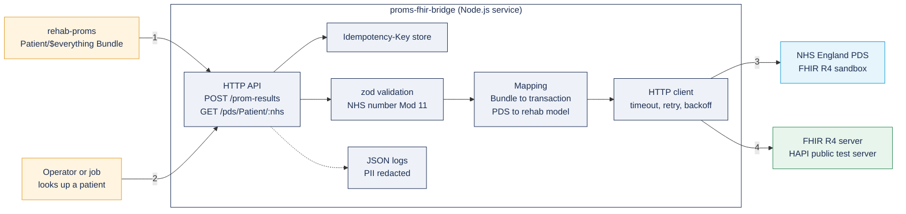

# PROMs FHIR Bridge

A small integration service that connects a PROM platform to NHS-style FHIR R4 interfaces:

- **Looks up a patient in the NHS England Personal Demographics Service (PDS)** FHIR API sandbox and maps the result into the patient model used by [rehab-proms](https://github.com/BenjisCollector/rehab-proms), keeping only what the PROM service needs and surfacing the two PDS flags that change how a patient must be treated (restricted record, deceased).
- **Pushes PROM results to a FHIR server**: takes the `Patient/$everything` Bundle that rehab-proms exports (`Patient`, `QuestionnaireResponse`, score `Observation`s) and sends it as one FHIR `transaction` that is safe to send more than once.

> **Status: portfolio project.** Not connected to any live NHS system, not assured by NHS England, and not for patient data. It talks only to the public PDS **sandbox** (fixed test data, no credentials) and the public HAPI FHIR **test** server. Only synthetic data is sent. See [Limitations](#limitations).

## Quick start

Requires Node.js 22 or later. No credentials needed.

```bash
npm ci
npm run build
npm start                          # listens on :8080
```

Or with Docker: `docker build -t proms-fhir-bridge . && docker run -p 8080:8080 proms-fhir-bridge`.

## Demo run (real output)

This is an unedited run against the live NHS England PDS sandbox and the public HAPI FHIR server, sending the synthetic Bundle in `test/fixtures/`:

```text
$ curl localhost:8080/pds/Patient/9000000009
{"given":"Jane","family":"Smith","birth_date":"2010-10-22","nhs_number":"9000000009","restricted":false,"deceased":true}

$ curl -X POST localhost:8080/prom-results \
    -H 'Idempotency-Key: demo-run-0001' -H 'content-type: application/fhir+json' \
    --data @test/fixtures/rehab-proms-everything.json
{"created":0,"existing":9,"locations":["Patient/438062/_history/1","QuestionnaireResponse/438063/_history/1", ...]}
```

`existing: 9` is the point: the same Bundle had already been sent once (that first send returned 9 x `201 Created`, recorded in `test/fixtures/hapi-transaction-response-created.json`). The second send created no duplicates. The service logs for that run contain no NHS number or name:

```text
{"level":"info","event":"request","correlationId":"aa57abee-...","method":"GET","path":"/pds/Patient/:id","status":200,"ms":1361}
{"level":"info","event":"prom_results.pushed","correlationId":"c426f5e1-...","entries":9,"created":0,"existing":9}
```

## API

| Method and path | Purpose | Notes |
|---|---|---|
| `GET /pds/Patient/{nhsNumber}` | PDS lookup mapped to the rehab-proms model | NHS number checked with Modulus 11 before any call; 404 passes through as `OperationOutcome` |
| `POST /prom-results` | Push a rehab-proms `$everything` Bundle to the FHIR server | Requires `Idempotency-Key`; returns `{created, existing, locations}` |
| `GET /healthz` | Liveness | |

All responses carry `x-correlation-id` (taken from the request if supplied, otherwise generated), which is also sent to PDS and the FHIR server so one request can be traced across systems.

Configuration (environment variables): `PDS_BASE_URL` (default: PDS sandbox), `FHIR_BASE_URL` (default: `https://hapi.fhir.org/baseR4`), `PORT` (8080), `LOG_LEVEL` (info).

## Architecture



1. rehab-proms exports a Bundle; a job posts it here. 2. Lookups by NHS number. 3. PDS is called with the required `X-Request-ID` header. 4. Results are written as one FHIR transaction.

### Design points

| Concern | How it is handled | Where |
|---|---|---|
| Typed FHIR | zod schemas for the subset of `Patient`, `QuestionnaireResponse`, `Observation`, `Bundle` the service relies on; unknown fields pass through untouched | `src/fhir.ts` |
| Idempotency, client side | `Idempotency-Key` header: same key and body replays the first result (also while it is still in flight); same key with a different body is `409` | `src/idempotency.ts` |
| Idempotency, server side | Every transaction entry is a conditional create (`ifNoneExist` on a stable identifier), so retries and replays never duplicate records. Verified against HAPI: first send 9 x `201`, second 9 x `200` | `src/mapping.ts` |
| Retries | Per-attempt timeout; retry only on network errors, 408, 429, 500, 502, 503, 504; exponential backoff with full jitter; honours `Retry-After`. Safe only because every request is idempotent | `src/http.ts` |
| References | Source ids are replaced by deterministic `urn:uuid` full URLs so the server links Observation to QuestionnaireResponse to Patient inside one atomic transaction | `src/mapping.ts` |
| Logging without PII | JSON lines; known PII keys masked at any depth; NHS-number-shaped strings masked anywhere; request paths logged with identifiers replaced by `:id`; validation errors report paths, never values | `src/logger.ts`, `src/app.ts` |
| Data minimisation | PDS mapping keeps name, date of birth and NHS number only; address, telecom, GP and contacts are dropped | `src/mapping.ts` |
| Safety flags | `restricted` (PDS security label R or V) and `deceased` are surfaced so the PROM service can withhold contact details and stop reminders | `src/mapping.ts` |

Decisions are recorded in [docs/adr](docs/adr).

## Testing

```bash
npm run lint && npm run typecheck && npm test
npm run contract:live     # optional: checks the real PDS sandbox still matches our schema
```

- **Contract tests against recorded fixtures**: `test/fixtures/` holds real responses recorded from the PDS sandbox (normal, restricted, not found), from HAPI (transaction created and transaction replayed), and a real rehab-proms export. Tests run the actual HTTP handler with the network replaced by these fixtures, so they are fast and deterministic.
- **Behaviour tests**: retry and backoff timings, `Retry-After`, give-up behaviour, idempotency replay, concurrency and conflict, body size limit, Modulus 11, log redaction (asserting logs never contain the NHS number or name).
- **Live drift check**: a weekly GitHub Actions job runs `contract:live` against the real sandbox, so a change on NHS England's side shows up as a failing job rather than a production incident.
- **CI** on every push: lint, typecheck, tests, build, and a Docker image build.

## Security and governance

- No credentials are needed or stored. Real PDS access (integration and production) needs NHS England onboarding, a signed connection agreement, and application-restricted (signed JWT) or user-restricted (NHS CIS2) OAuth; none of that is implemented.
- The Docker image runs as the non-root `node` user, with production dependencies only.
- The HAPI server is public: anything sent there is visible to anyone. Only obviously synthetic, `HTEST`-tagged data is sent.

## How AI coding tools were used and checked

Built with Claude Code (an AI coding assistant) from my specification. The AI drafted the code, tests and docs and ran them; the checks that guard it are the point:

- Contract fixtures are **recorded from the real services**, not written by the AI, so tests check behaviour against what PDS and HAPI actually return. Recording them surfaced real details a hand-written mock would have missed: the PDS sandbox patient 9000000009 is marked deceased, its name has an end date, and 9000000025 is a restricted record.
- The idempotency claim was verified live (send twice, `201` then `200`) before being written in this README.
- Tests for retry timings and log redaction assert exact outputs, so a plausible-looking but wrong change fails.
- I would treat any AI-generated change here like a supplier pull request: CI green, checklist in [CONTRIBUTING.md](CONTRIBUTING.md), and a human reviewer who reads every line.

## Limitations

- Sandbox and public test server only; no authentication to PDS or to the FHIR server.
- The idempotency store is in memory: correct for one instance, not for several (ADR 0002).
- Only the rehab-proms Bundle shape is accepted; this is not a general FHIR router.
- No UK Core profile validation (for example with the HL7 FHIR Validator); schemas check structure the service depends on, not full conformance.
- No queue or dead-letter handling: a failed push is returned to the caller to retry.

## Licence

MIT, see [LICENSE](LICENSE).
